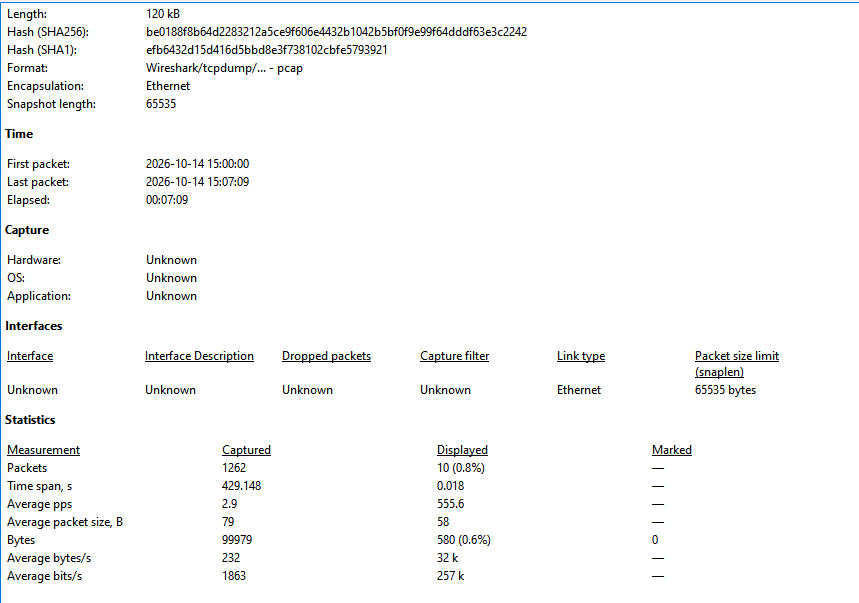
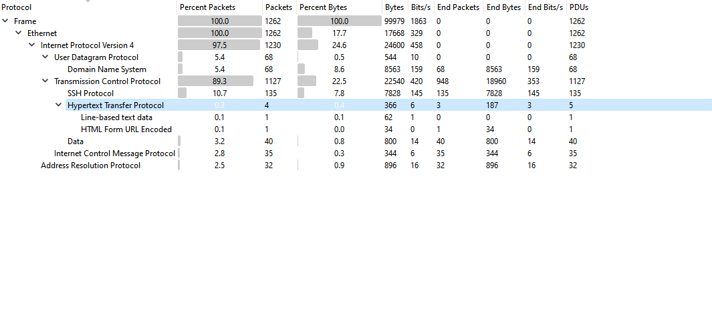
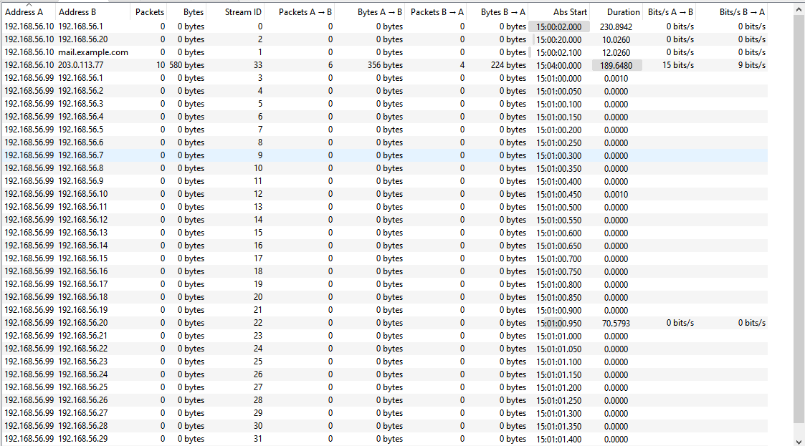
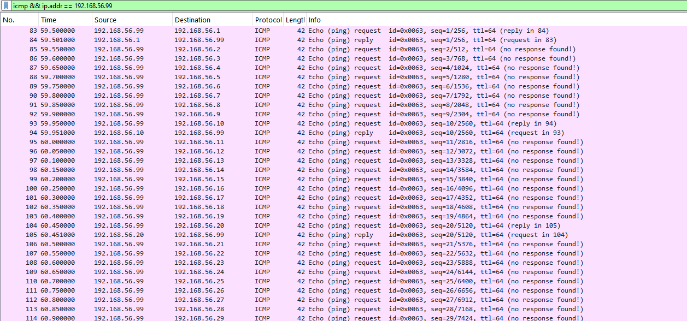
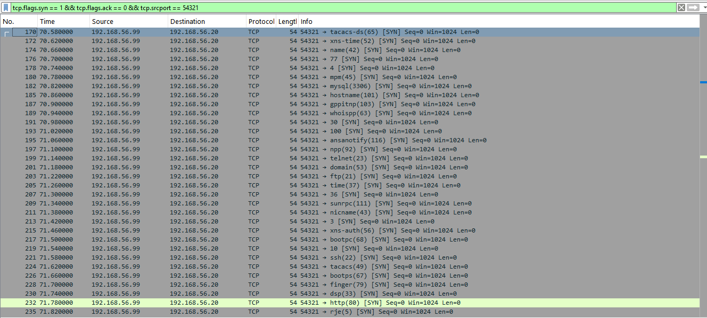
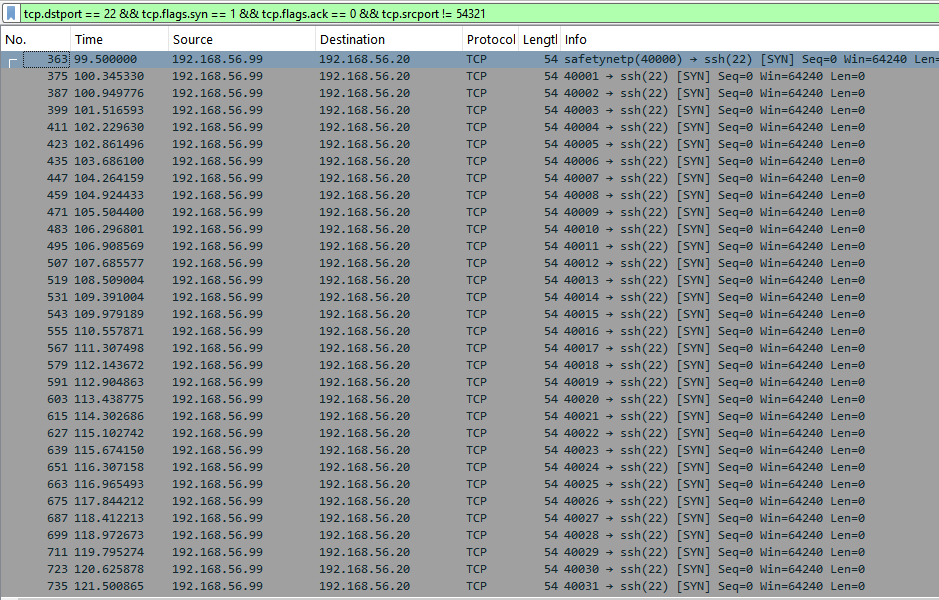
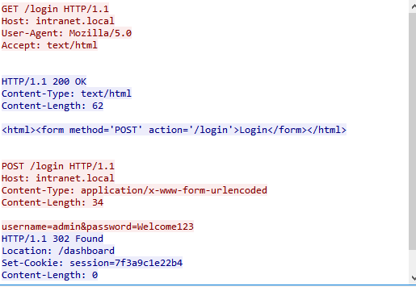
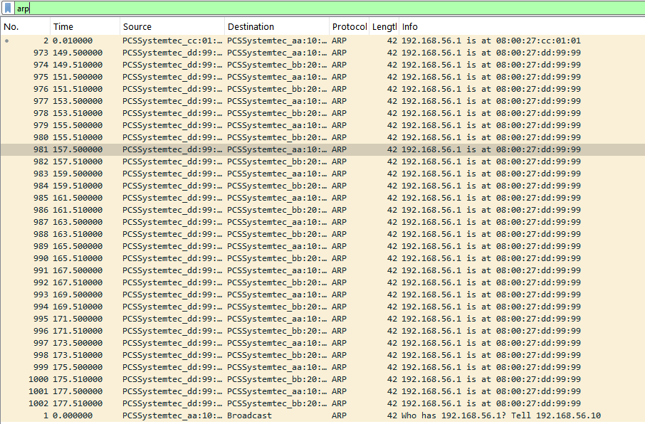
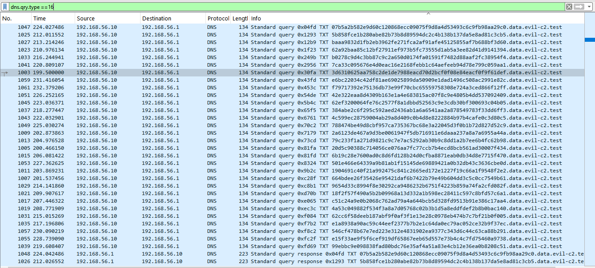
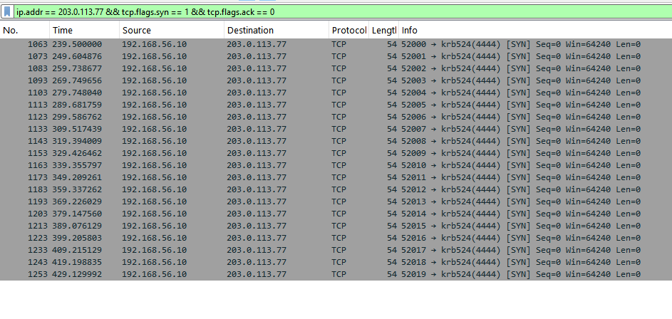

# Wireshark Traffic Analysis: Investigating a Practice Capture

**Author:** Qasim Mujahid
**Capture file:** `soc-practice-1.pcap` (a practice capture with fake lab addresses, no real data)
**Tool:** Wireshark

## What this project is about

I wanted to practice what a SOC analyst does when a packet capture lands on their desk: find out who is talking to whom, spot anything that does not look normal, and explain it in a short report.

The file has 1,262 packets, so reading every packet one by one made no sense. Instead I used Wireshark's statistics and filters to split the traffic into groups, checked each group, and then added the groups up to make sure the whole capture was explained.

## How I worked

1. Looked at the overview first (capture properties, protocol hierarchy, conversations).
2. Worked out what each IP address was doing.
3. Used one filter per suspicious pattern.
4. Added up the groups and checked the leftover traffic.
5. Checked Expert Information for anything I might have missed.

## Capture overview

| Item | Value |
|---|---|
| Total packets | 1,262 |
| Time | 15:00:00 to 15:07:09 on 2026-10-14 (about 7 minutes, 429 seconds) |
| Size | about 120 kB |
| Protocols | TCP 89.3%, DNS over UDP 5.4%, ICMP 2.8%, ARP 2.5% |
| Most active pair | 192.168.56.99 and 192.168.56.20 (859 packets, about 68% of everything) |

What stood out first from the protocol hierarchy:

- SSH was about 11% of all packets (135), which is a lot for a short capture.
- There were more ICMP, ARP and DNS packets than I would expect from normal use.
- 40 packets were shown only as raw "Data", which usually means Wireshark does not recognize the protocol.
- HTTP was only 4 packets, but one of them was an HTML form being submitted, which is worth a look.

## Hosts

| IP address | What I think it is | Why |
|---|---|---|
| 192.168.56.1 | Gateway and DNS server | It answers every DNS query and appears in the ARP traffic |
| 192.168.56.10 | Workstation | It makes the DNS lookups, browses and logs in to the web server |
| 192.168.56.20 | Internal server | It receives the HTTP and SSH connections and is the target of the scan |
| 192.168.56.99 | Attacker | It sweeps, scans and brute-forces, and it sends the fake ARP replies |
| 203.0.113.50 | Normal outside website | Regular HTTPS browsing. Wireshark shows it as `mail.example.com` because it learned the name from the DNS answers |
| 203.0.113.77 | Suspicious outside server | The workstation connects to it on port 4444 at fixed intervals |

## Findings

### 1. Ping sweep

- **From:** 192.168.56.99 to every address from .1 to .30
- **Filter:** `icmp && ip.addr == 192.168.56.99`
- **Packets:** 83 to 115, starting at about 59.5 seconds
- **What I saw:** one echo request after another to a new address every 0.05 seconds. Only .1, .10 and .20 replied. Wireshark marks the others as "no response found". Normal ping is one or two requests to one host.
- **Why it matters:** the attacker was checking which machines were alive before going further.
- **ATT&CK:** T1018 Remote System Discovery
- **What I would do:** find out if 192.168.56.99 is an approved scanner. If not, isolate it.

### 2. Port scan

- **From:** 192.168.56.99 to 192.168.56.20
- **Filter:** `tcp.flags.syn == 1 && tcp.flags.ack == 0 && tcp.srcport == 54321`
- **Packets:** 116 to 362, starting at about 70 seconds
- **What I saw:** 122 SYN packets, all from source port 54321, each to a different destination port (ftp 21, ssh 22, telnet 23, domain 53, http 80, mysql 3306 and many more), about every 0.04 seconds. Every packet used a small window size of 1024, which is common with scanning tools. Closed ports answered with RST-ACK. Ports 22, 80 and 3306 answered with SYN-ACK, so they are open, and the scanner then sent a RST instead of finishing the handshake.
- **Why it matters:** a normal user connects to one port. This is a SYN scan looking for services to attack.
- **ATT&CK:** T1046 Network Service Discovery
- **What I would do:** block or isolate the source and check what it did to the open ports next.

### 3. SSH brute force

- **From:** 192.168.56.99 to 192.168.56.20 on port 22
- **Filter:** `tcp.dstport == 22 && tcp.flags.syn == 1 && tcp.flags.ack == 0 && tcp.srcport != 54321`
- **Packets:** 363 to 972, from about 99.5 seconds to about 131 seconds
- **What I saw:** 46 separate connections, one every 0.5 to 0.9 seconds, with source ports counting up from 40000 to 40045. Each connection was about 12 packets and ended with a reset. The last connection was much bigger (70 packets) with data going both ways.
- **Why it matters:** this looks like a tool trying passwords over and over. The long last session may mean one attempt worked.
- **ATT&CK:** T1110 Brute Force
- **What I would do:** check the server's login logs, reset the password, block the source, and treat the server as possibly compromised.

### 4. Password sent in plain text

- **From:** 192.168.56.10 to 192.168.56.20 on port 80
- **Filter:** `http`, then Follow, TCP Stream on the POST request
- **Packets:** 69 to 82, at about 30 seconds
- **What I saw:** the TCP stream shows the whole login: the browser asks for `/login`, the server returns the form, the browser sends a POST with the username and password in readable text, and the server answers with a redirect and a `Set-Cookie` session value that is also readable.
- **Why it matters:** anyone sniffing the network can read the password. They could also copy the session cookie and take over the session. The ARP spoofing later in this capture would make this easy.
- **ATT&CK:** T1040 Network Sniffing
- **What I would do:** move the login to HTTPS, change that password and invalidate the session.

### 5. ARP spoofing

- **From:** a device with MAC `08:00:27:dd:99:99` (the attacker)
- **Filter:** `arp`
- **Packets:** 973 to 1002, from about 149.5 to 177.5 seconds
- **What I saw:** at the start, the real gateway answers ARP with its own MAC, which ends in `cc:01:01`. Later, the attacker's MAC keeps saying that 192.168.56.1 is at its address. The replies repeat every 2 seconds without anyone asking, alternating between the workstation and the server (15 replies each).
- **Why it matters:** this is how an attacker places itself between a host and the gateway so that traffic passes through it. Expert Information also flags a duplicate IP address for 192.168.56.1.
- **ATT&CK:** T1557.002 ARP Cache Poisoning
- **What I would do:** isolate the attacking host and turn on dynamic ARP inspection on the switch.

### 6. DNS tunneling

- **From:** 192.168.56.10 to the DNS server 192.168.56.1
- **Filter:** `dns.qry.type == 16`
- **Packets:** 1003 to 1062, from about 199.5 to 232 seconds
- **What I saw:** 30 TXT queries (60 packets with the replies) to random-looking names made of 56 hex characters, all ending in `.data.evil-c2.test`. The queries are 134 bytes and the replies are 223 bytes. Normal names in the same file were short, like `github.com`.
- **Why it matters:** attackers can hide stolen data inside long DNS names and receive instructions in the TXT replies.
- **ATT&CK:** T1071.004 Application Layer Protocol: DNS
- **What I would do:** block the domain, isolate the workstation and look for what data left through DNS.

### 7. Beaconing to a suspicious server

- **From:** 192.168.56.10 to 203.0.113.77 on port 4444
- **Filter:** `ip.addr == 203.0.113.77 && tcp.flags.syn == 1 && tcp.flags.ack == 0`
- **Packets:** 1063 to 1262, from about 239.5 to 429 seconds
- **What I saw:** 20 connections with gaps of almost exactly 10 seconds (the time column goes 239.5, 249.6, 259.7, 269.7 and so on). The whole conversation is 200 packets, and the small payloads are probably the 40 "Data" packets in the protocol hierarchy. Wireshark labels port 4444 as `krb524`, but that is only the name registered for the port. Nothing in this traffic is Kerberos.
- **Why it matters:** people do not browse on a perfect timer, but malware checking in with its controller does. Port 4444 is also a port often used by hacking tools.
- **ATT&CK:** T1095 Non-Application Layer Protocol
- **What I would do:** block 203.0.113.77, isolate the workstation and start an incident investigation.

## Making sure I did not miss anything

I added up the groups by packet number:

| Packets (No.) | What they are | Count |
|---|---|---|
| 1 to 82 | Normal traffic: ARP, DNS, HTTPS, one ping and the HTTP login | 82 |
| 83 to 115 | Ping sweep | 33 |
| 116 to 362 | Port scan and its replies | 247 |
| 363 to 972 | SSH brute force | 610 |
| 973 to 1002 | ARP spoofing | 30 |
| 1003 to 1062 | DNS tunneling | 60 |
| 1063 to 1262 | Beaconing | 200 |
| **Total** | | **1,262** |

To check the normal traffic I used a filter that hides everything I had already explained:

`!(ip.addr == 192.168.56.99) && !(ip.addr == 203.0.113.77) && !arp && !dns && !icmp`

What remained was ordinary HTTPS to 203.0.113.50 and the HTTP login. The HTTPS connections look like textbook TCP: SYN, SYN-ACK, ACK, then data with PSH-ACK, then FIN-ACK to close. That is a useful comparison, because the scan and brute force packets did not follow this pattern.

I also checked Expert Information. The warnings matched what I found: a duplicate IP address for the gateway, and a large number of resets (167 in total, mostly from the scan and the SSH attempts).

## Timeline

| Time in capture | What happened |
|---|---|
| 0 to 20 s | Normal DNS lookups, HTTPS browsing, one ping |
| about 30 s | Workstation logs in to the web server over HTTP, password visible |
| about 60 s | 192.168.56.99 sweeps .1 to .30 |
| about 70 s | 192.168.56.99 scans the server's ports |
| about 100 to 131 s | SSH brute force, ending with one long session |
| about 150 to 178 s | Fake ARP replies pretending to be the gateway |
| about 200 to 232 s | DNS tunneling from the workstation |
| about 240 to 429 s | Workstation beacons to 203.0.113.77 every 10 seconds |

## Summary

One machine on the network (192.168.56.99) looked for live hosts, scanned the server for open ports, and then hammered the SSH service until a long session appeared. After that it started poisoning ARP so traffic could pass through it. Later the workstation (192.168.56.10) showed signs of being compromised: it sent odd DNS queries with long random names and kept calling a server on port 4444 every 10 seconds.

## Recommendations

1. Isolate 192.168.56.99 and 192.168.56.10 from the network.
2. Block 203.0.113.77 and the `evil-c2.test` domain.
3. Reset the SSH and web passwords, and move the web login to HTTPS.
4. Turn on dynamic ARP inspection, limit SSH logins, and watch for repeated failed logins.

## What I learned

- You do not need to read every packet. Statistics and filters get you to the suspicious groups quickly.
- Patterns matter more than single packets: how often, how many, and how regular.
- Encrypted traffic hides the content, but IPs, ports, timing and size can still give an attacker away.
- Checking the leftover traffic and Expert Information is a good way to make sure nothing was missed.

## Limits

- This is a practice capture with simulated attacks and fake addresses.
- A pattern is not proof. In a real case I would first check whether the host is expected to do this, for example an approved vulnerability scanner.
- I cannot read encrypted traffic, so some findings would need other logs to confirm.
